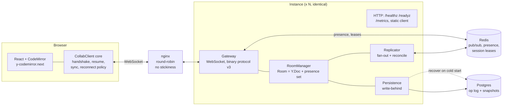
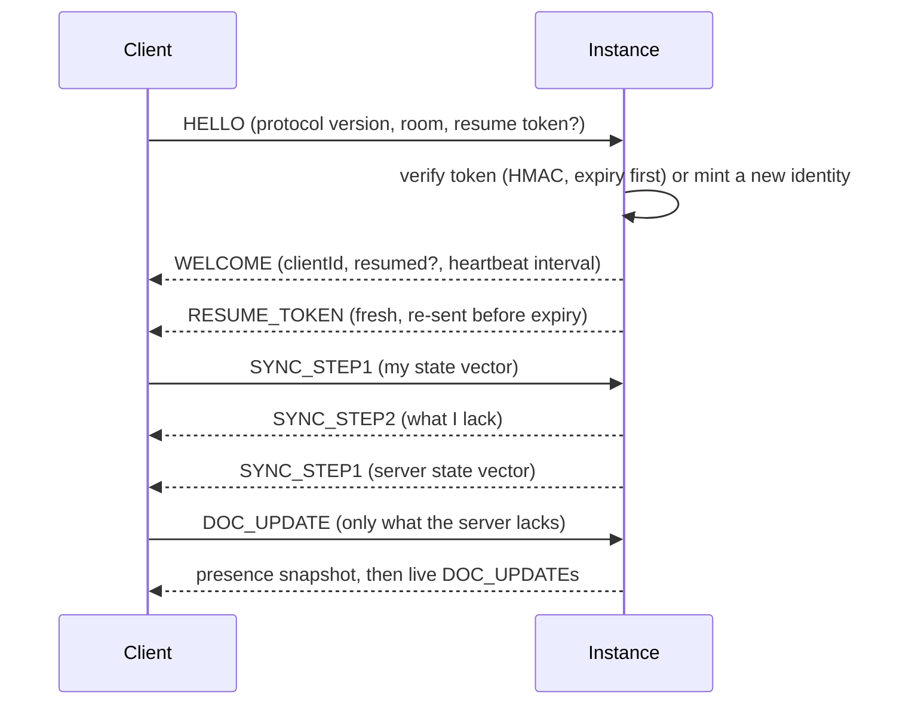
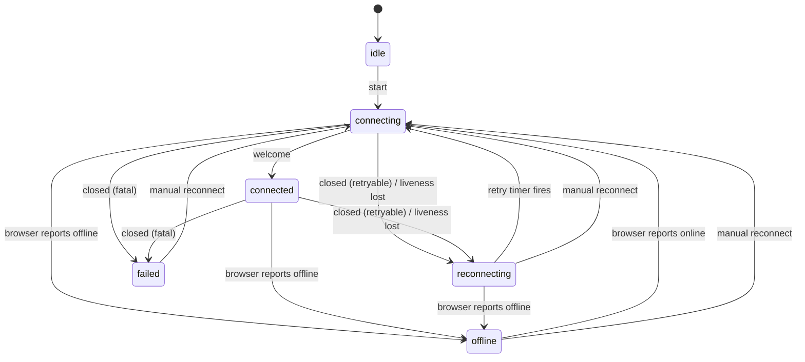

# Architecture

Strand is a set of identical, stateless server instances behind a plain
round-robin load balancer. Any instance can serve any client in any room. This
document describes the pieces, follows one edit through them, shows the client's
connection state machine, and walks the failure modes, saying for each what
happens and what proves it.

The decisions behind it are recorded in [docs/adr](adr/); this document links
to them rather than repeating their reasoning.

## Components



| Piece | Responsibility | Where |
|---|---|---|
| Client core | Everything about talking to the server that is not DOM: handshake, resume token, state-vector sync, the reconnect state machine, liveness detection. Shared by the browser UI and the integration tests, so tests exercise the shipped logic ([ADR 0005](adr/0005-shared-client-core-and-liveness.md)) | `src/client` |
| Gateway | WebSocket server: handshake, size caps, heartbeat, backpressure, close codes | `src/gateway` |
| Room | One `Y.Doc` and one presence set per room per instance, plus local fan-out to that instance's sockets | `src/room` |
| Replicator | Redis pub/sub fan-out between instances, plus periodic reconciliation ([ADR 0002](adr/0002-fanout-pubsub-with-reconciliation.md)) | `src/transport` |
| Presence / session stores | Presence entries and session leases in Redis, written by Lua scripts that read Redis's own clock ([ADR 0001](adr/0001-presence-lww-set.md), [ADR 0003](adr/0003-stateless-resume-tokens-with-lease-fencing.md)) | `src/transport` |
| Persistence | Write-behind op log and snapshots in Postgres ([ADR 0004](adr/0004-write-behind-persistence.md)) | `src/persistence` |
| API | Liveness, readiness, metrics, static files ([ADR 0006](adr/0006-liveness-readiness-and-plain-round-robin.md)) | `src/api` |

No instance is the authority for a room. The document is a CRDT, so every
instance hosting a room holds a full replica and replicas converge by
exchanging updates in any order.

## The path of one edit

```mermaid
sequenceDiagram
  participant A as Client A
  participant IA as Instance 1
  participant R as Redis
  participant IB as Instance 2
  participant B as Client B
  participant PG as Postgres

  A->>IA: DOC_UPDATE (Yjs update)
  IA->>IA: apply to Room doc (idempotent)
  IA-->>A: (nothing: the sender is not echoed)
  par local fan-out
    IA->>IA: send to other sockets on this instance
  and cross-instance fan-out
    IA->>R: PUBLISH envelope {origin: 1, sentAt, update}
    R->>IB: envelope
    IB->>IB: drop if origin is me; else apply
    IB->>B: DOC_UPDATE
  and persistence (origin only)
    IA->>IA: buffer op
    IA-)PG: flush op batch (~every 250 ms)
  end
  Note over IA,IB: every ~5 s each instance publishes a state vector +<br/>delete-set digest per room; a peer that differs replies with<br/>exactly what the sender lacks. This is what makes lost<br/>pub/sub messages harmless.
```

Points worth noticing:

- **Pub/sub is the optimisation; reconciliation is the correctness mechanism.**
  Redis pub/sub can drop messages, so nothing depends on it for correctness. A
  dropped message delays convergence by about one reconcile interval; it cannot
  prevent it.
- **Only the instance that received an edit from a client logs it** (receivers
  apply a remote update but do not write it). That makes each edit one log row,
  not one per instance, without any election.
- **Loop prevention is explicit.** Envelopes carry their origin; an instance
  drops its own. Correctness never relied on idempotence to stop loops.
- **Join is an exchange of state vectors.** The client says what it has, the
  server replies with only the difference and sends its own vector so the client
  returns only what the server lacks. Reconnect cost is proportional to what was
  missed, not to document size.

### Joining



The server withholds live updates from a client until it has answered that
client's `SYNC_STEP1`; before that rule existed, a reconnecting client was sent
the whole document twice.

## The client's connection state machine

This is the pure function in `src/protocol/reconnect.ts`. It has no timers,
sockets or randomness of its own, so every transition is unit-tested without
sleeping.



Close codes fall into three classes ([`src/protocol/types.ts`](../src/protocol/types.ts)):

| Class | Codes | Client does |
|---|---|---|
| Go now | 4000 server going away | reconnect with a small jitter; another instance will take it |
| Retry with backoff | 4002 heartbeat timeout, 4003 backpressure, 1006 and anything unrecognised | exponential from 500 ms, capped at 30 s, equal jitter |
| Do not retry | 4001 version mismatch, 4004 bad message, 4005 too large, 4006 superseded | stop and tell the user; retrying would loop or make two tabs evict each other forever |

"Offline" in the UI means the connection is useless, whether the browser said so
or the link merely went silent for ⌈1.5 × heartbeat⌉ + 1 s, so it does not wait
for TCP to give up. Failures reset only on a completed handshake, never merely
on an open socket.

## Failure modes

For each: what happens, and what shows it. "Test" means an automated test
against real Redis and Postgres (testcontainers), never a mock.

| Failure | What happens | Evidence |
|---|---|---|
| **Redis pub/sub drops messages** (burst, or 40% random loss across three instances) | Replicas diverge briefly, then reconciliation sends exactly the missing updates; converges within about one reconcile interval | Test: `replication.int.test.ts` heals a burst of drops, a deletion-only update (which a state vector alone cannot detect, hence the delete-set digest), and random 40% loss with a seeded generator |
| **Redis is unreachable** | `/readyz` returns 503 so a balancer stops sending new connections; the process stays up; clients on the same instance keep editing together; cross-instance sync pauses and catches up on recovery. Identity uniqueness weakens until Redis returns (see Limitations) | Test: `readiness.int.test.ts` severs a real Redis, checks 503, `/healthz` 200, local edits still flow, and recovery |
| **Postgres is unreachable** | Edits live in memory, ops buffer up to a bound, overflow forces a snapshot; nothing is dropped silently; writes resume on return | Tests in `persistence.int.test.ts`: an edit still reaches another client while Postgres writes are hung, an overflowing buffer sheds without losing content (the forced snapshot carries it), and a room opens without waiting forever on a hung database then merges in the persisted state. `cluster.int.test.ts`: all instances stopped and Redis flushed, the exact document is recovered |
| **An instance dies (SIGKILL)** | Its clients get a reset, reconnect through the balancer to another instance with their resume token, and exchange state vectors. Their presence expires after one TTL | Benchmark: 166 clients reconnected, median outage 437 ms, worst 2.5 s, 0 edits lost. Test: resuming on a different instance keeps identity and presence (`resume.int.test.ts`) |
| **An instance hangs (no reset)** | Clients detect silence after about 23.5 s and reconnect; nginx's passive checks cannot see a node that accepts and never answers, so about a third of reconnect attempts hang until the client's 8 s handshake timeout | Benchmark: median 25 s, worst 71 s, 0 edits lost. Unit test: a silent-but-open connection is called offline on its own (`src/client/core.test.ts`). Also checked by hand with a `SIGSTOP`ped server in a real browser (ADR 0005); that one is not automated. Mitigation is a balancer with active health checks ([ADR 0006](adr/0006-liveness-readiness-and-plain-round-robin.md)) |
| **The same identity connects twice** (two tabs, or a stale connection) | The newest wins; the older is fenced and closed with `Superseded`, which the client does not retry. The heartbeat's lease touch is the correctness mechanism; the fence message is the fast path | Tests: `sessionStore.int.test.ts`, `resume.int.test.ts` (mutation-checked: removing the touch backstop fails them) |
| **Client goes offline** | The UI says Offline; local edits accumulate in the page's memory and are handed over by the state-vector exchange on reconnect | Test: offline edits are kept, counted and merged (`src/client/core.test.ts`), and the integration suites drive the same core. Limitation: not saved if the tab is closed while offline |
| **Slow consumer** | Its outbound queue crosses a byte threshold and it is closed with 4003 rather than letting server memory grow | Unit test in `src/gateway/connection.test.ts`; not exercised at scale in the load tests (counter stayed 0) |
| **Malformed, oversized or wrong-version frames** | Closed with a fatal code; the client stops instead of looping | Codec and gateway tests |
| **Resume secret rotated, or token expired** | Token rejected; the client joins as a new identity (no data lost, only the seamless-resume fast path) | Test: `resume.int.test.ts`; counted as `token_rejected` in metrics |
| **Reconnect stampede after losing an instance** | Equal-jitter exponential backoff spreads retries | Benchmark: 166 simultaneous reconnects completed in under 2.5 s |
| **Two instances snapshot the same room at once** | Compare-and-swap on the snapshot version, merging with what is stored; the loser retries or yields | Tests: `cluster.int.test.ts` (mutation-checked). Metric: `strand_snapshot_conflicts_total` |
| **Compaction races a slow snapshotter** | A change could in principle be dropped from the log before any snapshot holds it; bounded by a retention window | Documented as a **timing assumption, not a proof** ([ADR 0004](adr/0004-write-behind-persistence.md)) |
| **Overload** | Latency percentiles blow out, slow clients are evicted for missing pings and resume on reconnect, snapshots slow down | Observed in the load tests, but the ceiling is not established; see the README's Benchmarks |

## Data

- **Redis** holds nothing that cannot be rebuilt: pub/sub is transient,
  presence entries expire by Redis's clock, session leases expire. Flushing it
  costs a reconnect wave, not data.
- **Postgres** holds the documents: an append-only op log (rows tagged with the
  snapshot version they follow, version assigned by the database) and one
  snapshot row per document, replaced by compare-and-swap. Cold start rebuilds a
  room from the snapshot plus later ops, with a bounded wait so a hung database
  cannot hang a join.
- **Instances** hold rooms in memory and nothing else that matters. Killing one
  loses at most the last flush interval of edits that only it had received.

## What is deliberately not here

There is no authentication or access control, no multi-region story, no paging of
large documents, and no offline persistence in the browser. The README's
Limitations section lists these with their consequences.
